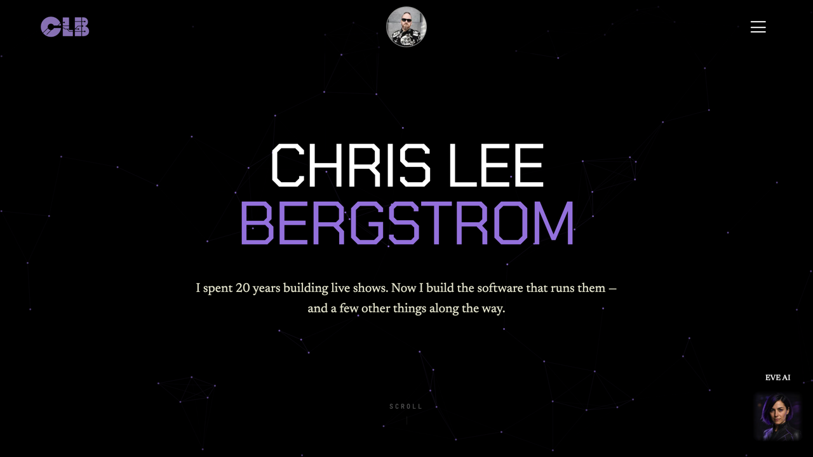
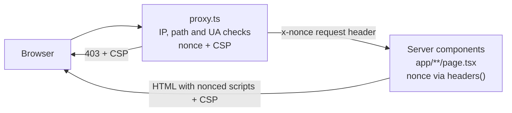
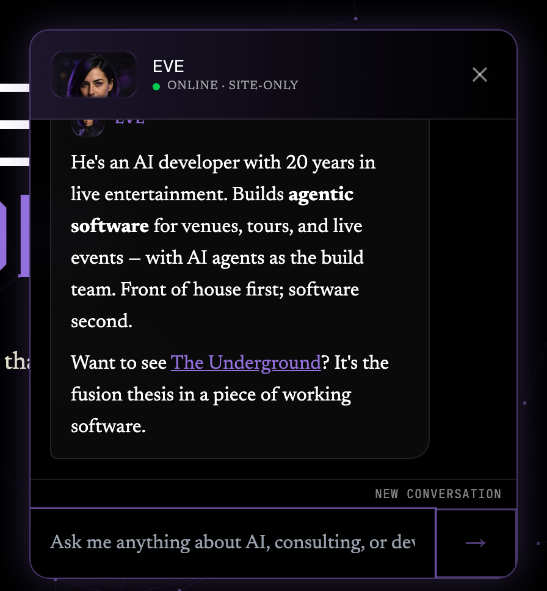

# chrisleebergstrom.com

Personal site of Chris Lee Bergstrom, and EVE, an AI concierge you can talk to.

[](https://github.com/Nxtvanhalen/Website/actions/workflows/ci.yml)
[](LICENSE)

**Live:** [chrisleebergstrom.com](https://chrisleebergstrom.com)



## What this is

The production site for Chris Lee Bergstrom, an AI developer with twenty years in live entertainment. It is a Next.js 16 App Router app with a strict, per-request-nonce Content Security Policy, and it ships EVE, a site-scoped assistant that streams replies from the OpenAI Responses API. The implementation is worth reading if you want a small, real-world example of a nonce CSP on the App Router, a validated and rate-limited LLM endpoint, and accessibility checks that run in CI on every route.

## Highlights

- **Nonce CSP on every response.** `proxy.ts` generates a nonce per request and sets `script-src 'self' 'nonce-…' 'strict-dynamic'` on everything except Next's build assets (`/_next/static`, `/_next/image`): pages, API responses, 403s and allowlisted crawlers alike. Every route renders dynamically so framework scripts carry the nonce; violations are reported to Sentry through `report-uri` and `report-to`.
- **EVE streams, with guardrails.** `/api/chat` calls the OpenAI Responses API directly with `fetch` (no SDK), relays the SSE stream as NDJSON, and refuses cross-site, non-JSON, oversized (16 KB) and malformed requests. Rate limits: 20 requests/minute per IP and 300/hour per instance; replies are capped at 800 output tokens, and the upstream call is cancelled when the visitor leaves.
- **Accessibility checked in CI.** Playwright runs axe (WCAG 2.1 A/AA rules) on every route in the sitemap against a production build and fails on serious or critical violations. The menu drawer, FAQ accordion, chat dialog and skip link have keyboard tests.
- **Sentry with PII collection off.** No request bodies, cookies or IPs leave the server (`sentry.shared.ts`); browser events tunnel through `/monitoring` on the site's own origin.
- **Privacy-first analytics.** Google Analytics loads only after consent (vanilla-cookieconsent); withdrawing consent erases its cookies. Plausible runs cookieless.
- **AI-crawler friendly.** `public/robots.txt`, `public/llms.txt` and `public/ai.txt` welcome and brief AI crawlers; every content page carries JSON-LD.

## Architecture



```mermaid
sequenceDiagram
  participant C as ChatPanel (client)
  participant R as /api/chat (route.ts)
  participant O as OpenAI Responses API
  C->>R: POST JSON (prompt, previousResponseId?, context?)
  R->>R: same-origin, content-type, rate limit, body cap, validation
  R->>O: POST /v1/responses, stream: true
  O-->>R: SSE events
  R-->>C: NDJSON lines: delta… then done or error
  C->>C: reveal text, then render markdown; store responseId
```

The CSP design, the Next.js migration it required and the gotchas hit along the way are written up in [docs/CSP-AND-NEXTJS-ROADMAP.md](docs/CSP-AND-NEXTJS-ROADMAP.md). Conventions and the EVE internals are in [docs/DEVELOPMENT.md](docs/DEVELOPMENT.md).



## Tech stack

| Layer | What | Major version |
| --- | --- | --- |
| Framework | Next.js (App Router, Turbopack), React | 16, 19 |
| Language | TypeScript | 7 |
| Styling | Tailwind CSS (CSS-first `@theme` in `styles/global.css`) | 4 |
| Animation | motion (`MotionConfig reducedMotion="user"`) | 14 |
| Runtime and package manager | Bun (`.bun-version`) | 1.4 |
| Lint and format | Biome | 2 |
| Errors and CSP reports | @sentry/nextjs | 11 |
| E2E and accessibility | Playwright, @axe-core/playwright | 1, 4 |
| Chat rendering | react-markdown, remark-gfm | 10, 4 |
| RSS parsing | fast-xml-parser | 5 |
| Cookie consent | vanilla-cookieconsent | 3 |
| AI | OpenAI Responses API via `fetch`, model `gpt-5-nano-2025-08-07` | – |
| Analytics | Google Analytics 4 (consent-gated), Plausible (cookieless) | – |
| Hosting | Render web service | – |

## Project structure

```
.
├── app/                    # App Router: one server component per route + API routes
│   ├── layout.tsx          #   root layout, metadata, fonts, nonce for Plausible
│   ├── page.tsx            #   home: JSON-LD + sections as children of IndexClient.tsx (client hero)
│   ├── about/ projects/ news/ blog/ faq/ privacy/ sms/
│   ├── api/chat/route.ts   #   EVE endpoint
│   ├── api/substack/route.ts
│   ├── sitemap.ts          #   also the route list the e2e suite iterates
│   ├── not-found.tsx · global-error.tsx · og-image.ts
├── components/             # Header, Footer, ChatPanel, PersistentChat, Reveal, PageHero, PageCta…
├── context/ChatContext.tsx # chat open state + EVE context
├── lib/                    # pure logic, unit-tested: eve-*, proxy-security, substack-parse, projects…
├── styles/global.css       # Tailwind theme tokens + header/menu/footer/chat CSS
├── public/                 # images, videos, robots.txt, llms.txt, ai.txt, sw.js (self-unregistering stub)
├── tests/                  # unit/, integration/, e2e/ (Playwright + axe), fixtures/
├── docs/                   # DEVELOPMENT.md, CSP-AND-NEXTJS-ROADMAP.md, screenshots
├── proxy.ts                # request filtering + per-request CSP (Next 16 "proxy", ex-middleware)
├── instrumentation*.ts · sentry.*.ts
├── next.config.js · biome.json · playwright.config.ts · bunfig.toml · tsconfig.json
└── .github/                # workflows/ci.yml, dependabot.yml
```

## Running locally

Requires Bun 1.4.3 (`.bun-version`).

```bash
bun install
cp .env.example .env.local      # then set OPENAI_API_KEY for EVE
bun run dev                     # http://localhost:3000
```

Production build:

```bash
bun run build && bun run start
```

`next dev` relaxes the CSP (`'unsafe-eval'` and inline styles for HMR); run the production build to see the enforced policy.

## Scripts

| Script | What it does |
| --- | --- |
| `bun run dev` | Dev server with HMR |
| `bun run build` | Production build (uploads source maps to Sentry only if `SENTRY_AUTH_TOKEN` is set) |
| `bun run start` | Serve the production build |
| `bun run check` | `biome ci` (lint + format check), what CI runs |
| `bun run lint` / `bun run lint:fix` | Biome lint only / lint and fix |
| `bun run format` | Biome format in place |
| `bun run typecheck` | `tsc --noEmit` |
| `bun run test` | Unit and integration tests (`bun test tests/unit tests/integration`) |
| `bun run test:e2e` | Playwright: builds, starts the site and runs `tests/e2e` (set `PLAYWRIGHT_SKIP_BUILD=1` to reuse `.next`) |

## Environment variables

From `.env.example`; git ignores every other `.env*` file.

| Variable | Required | Purpose |
| --- | --- | --- |
| `OPENAI_API_KEY` | Yes (for EVE) | Server-side key used by `app/api/chat/route.ts`. The build never calls OpenAI; CI uses a placeholder. |
| `SENTRY_AUTH_TOKEN` | No | Source-map upload during `next build`. Unset, the build still succeeds. |
| `NEXT_PUBLIC_SENTRY_ENV` | No | Environment tag on Sentry events (defaults to `production`). |
| `CSP_REPORT_ONLY` | No | `true` sends the policy as `Content-Security-Policy-Report-Only`; anything else enforces. |
| `BLOCKED_IPS` | No | Comma-separated client IPs that get a 403 on every request. |
| `BLOCKED_IP_PREFIXES` | No | Comma-separated IPv4 prefixes (`"43.131.,170.106."`); phone user-agents from these ranges get a 403. |

`NODE_ENV`, `NEXT_RUNTIME` and `CI` are set by the platform.

## Testing

- **Unit** (`tests/unit`, `bun test`): the pure modules in `lib/`: request validation, the SSE-to-NDJSON reducer and stream, the rate limiter, chat storage (de)serialisation, CSP construction and request classification, Substack feed parsing.
- **Integration** (`tests/integration`, `bun test`): `proxy.ts` end to end for each environment variant (default, `BLOCKED_IPS`, `BLOCKED_IP_PREFIXES`, `CSP_REPORT_ONLY`), its matcher via Next's `unstable_doesMiddlewareMatch`, and `POST /api/chat` with a mocked OpenAI, covering every refusal path (403, 415, 413, 400, 429), the stale-conversation 409 and a healthy relay.
- **End-to-end** (`tests/e2e`, Playwright, Chromium, against `next build && next start`): for every route in `app/sitemap.ts`: a 200, one `h1`, a `main` landmark, the enforced CSP header, no CSP violations or hydration errors in the console, and no serious or critical axe violations. Plus the EVE panel with `/api/chat` mocked, the menu drawer, the skip link, the FAQ accordion and the 404 page.

At the time of writing that is 124 unit and integration tests and 34 e2e tests. CI (`.github/workflows/ci.yml`) runs `check` → `typecheck` → `test` first, then `build` and the e2e job in parallel; the Playwright report is uploaded as an artifact when e2e fails.

## Security

Request filtering and the CSP live in `proxy.ts` and `lib/proxy-security.ts`; the chat endpoint's validation in `lib/eve-validation.ts`. Other security headers (HSTS, `X-Frame-Options`, `X-Content-Type-Options`, `Referrer-Policy`, `Permissions-Policy`) are set in `next.config.js`.

Some identifiers are in the source on purpose and are not secrets: the Sentry DSN and the CSP report endpoint (write-only ingest addresses), the Google Analytics measurement ID, the Plausible script URL and the Search Console verification file. Real secrets (`OPENAI_API_KEY`, `SENTRY_AUTH_TOKEN`) exist only in the environment.

To report a vulnerability, see [SECURITY.md](SECURITY.md).

## Deployment

The site runs as a Render web service.

- Build command: `bun install && bun run build`. Start command: `bun run start`. (Confirm in the Render dashboard; the Bun version must be 1.4.2.)
- **Deploys are manual.** Auto-deploy is off, so pushing to `main` does not deploy; trigger the deploy from the Render dashboard or the Render CLI after CI is green.
- Environment: `OPENAI_API_KEY` (required); `SENTRY_AUTH_TOKEN`, `NEXT_PUBLIC_SENTRY_ENV`, `BLOCKED_IPS`, `BLOCKED_IP_PREFIXES` as needed.
- Safe CSP rollout: set `CSP_REPORT_ONLY=true`, deploy, watch the CSP issues in Sentry, then remove the variable to enforce.

## Related work

Live projects linked from the site:

| Project | What | Where |
| --- | --- | --- |
| The Underground | Venue-management sim, a browser game | [underground-venue-manager.onrender.com](https://underground-venue-manager.onrender.com) |
| Byte | AI assistant over email: write to byte@firstlyte.co | [firstlyte.co](https://firstlyte.co) · [source](https://github.com/Nxtvanhalen/byte-mail) |
| Beacons | SPL and acoustic monitoring for live events | [beaconsio.com](https://beaconsio.com) |
| Fuel Estimator | Tour-bus fuel cost calculator | [fuel-estimator.onrender.com](https://fuel-estimator.onrender.com) |

## License

The code is licensed under the [GNU AGPL-3.0](LICENSE). The site's content, images and video, the EVE persona and system prompt text, and the names "Chris Lee Bergstrom" and "EVE" are not covered by that license: © Chris Lee Bergstrom, all rights reserved. See [NOTICE](NOTICE).

## Contact

- Email: [chrisleebergstrom@gmail.com](mailto:chrisleebergstrom@gmail.com)
- LinkedIn: [chris-bergstrom](https://www.linkedin.com/in/chris-bergstrom)
- GitHub: [@Nxtvanhalen](https://github.com/Nxtvanhalen)
